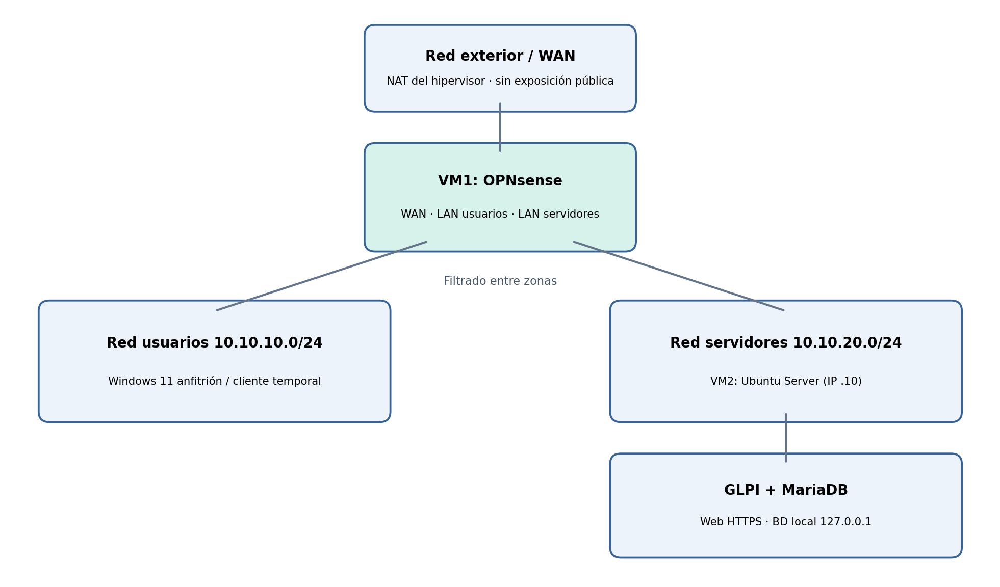

# PIMAS · Entrega 2

**Análisis de requisitos, diseño de infraestructura, riesgos y planificación**

Asesoría Tajo Gestión, S. L. · Empresa ficticia en Talavera de la Reina
Alumno: Jesús Conde · 25 de octubre de 2026
Estado: diseño propuesto; pendiente de validación práctica

## 1. Contexto y alcance

La asesoría simulada cuenta con 18 trabajadores repartidos entre dirección/administración, fiscal-contable y laboral. El crecimiento de la plantilla no ha ido acompañado de segmentación de red, definición formal de permisos, protección de los servicios internos ni procedimientos comprobados de recuperación.

Se propone un laboratorio reducido que represente esos riesgos y permita probar medidas correctoras sin utilizar información real.

El laboratorio no reproduce 18 puestos físicos. Utilizará cuentas de prueba para representar departamentos y un cliente de pruebas para verificar las restricciones.

No se pretende acreditar cumplimiento integral del RGPD ni desplegar un servicio productivo.

## 2. Requisitos funcionales y de seguridad

| ID | Requisito | Verificación prevista |
| --- | --- | --- |
| RF-01 | Acceso autenticado a la aplicación web interna | Inicio de sesión con cuenta válida e inválida |
| RF-02 | Perfiles separados para dirección, fiscal, laboral y técnico | Comprobar permisos distintos en GLPI |
| RF-03 | Registro de solicitudes internas y activos de prueba en GLPI | Crear y consultar ticket y activo ficticios |
| RF-04 | Persistencia de la aplicación en MariaDB | Comprobar conexión y datos tras reinicio |
| RS-01 | Separación de usuarios y servidores mediante firewall | Pruebas de tráfico permitido y denegado |
| RS-02 | Acceso web autorizado; administración restringida | HTTPS permitido y SSH bloqueado desde usuarios |
| RS-03 | Registro de decisiones del firewall | Consultar eventos de conexiones bloqueadas |
| RS-04 | Copia y restauración de BD y configuración | Restaurar en entorno de prueba |
| RS-05 | Bastionado básico de Linux y servicio web | Revisión de puertos, cuentas y actualizaciones |

La VPN queda como extensión condicionada a los recursos y al avance de los requisitos anteriores. IDS/IPS y SIEM completos quedan fuera del alcance obligatorio.

## 3. Arquitectura de red

Esquema lógico provisional.

OPNsense tendrá tres interfaces virtuales: WAN conectada a NAT para descargas/actualizaciones, red de usuarios y red de servidores.

La conexión del Windows 11 anfitrión a la red de usuarios dependerá de la configuración del hipervisor; alternativamente se arrancará un cliente Linux temporal. No se abrirán puertos de la WAN a Internet.

| Zona | Red propuesta | Equipos / puerta de enlace |
| --- | --- | --- |
| Usuarios | 10.10.10.0/24 | Firewall 10.10.10.1; cliente de prueba |
| Servidores | 10.10.20.0/24 | Firewall 10.10.20.1; Ubuntu 10.10.20.10 |
| WAN laboratorio | NAT del hipervisor | IP asignada automáticamente |

## 4. Aplicación y base de datos

Se propone GLPI como aplicación web de gestión interna de incidencias e inventario.

En una asesoría de 18 empleados permitiría canalizar solicitudes de soporte y registrar equipos, sin desarrollar software propio. GLPI requiere un SGBD compatible; se prevé MariaDB, instalado en el mismo Ubuntu Server para limitar el consumo de recursos. La versión y sus requisitos exactos se verificarán antes del despliegue.

La base de datos almacenará usuarios, incidencias y activos de prueba de GLPI; no se almacenarán expedientes reales de clientes. La conexión a MariaDB se limitará al servidor local (127.0.0.1) y no se publicará el puerto 3306 a las redes de usuarios. HTTPS se configurará con certificado de laboratorio, explicando sus limitaciones.

## 5. Usuarios, permisos y reglas

| Perfil | Perfil | Acceso previsto | Acceso previsto |
| --- | --- | --- | --- |
| Empleado fiscal | Empleado fiscal | Iniciar/consultar sus tickets; sin administración | Iniciar/consultar sus tickets; sin administración |
| Empleado laboral | Empleado laboral | Iniciar/consultar sus tickets; sin administración | Iniciar/consultar sus tickets; sin administración |
| Dirección | Dirección | Consultar informes o tickets según permisos configurados | Consultar informes o tickets según permisos configurados |
| Administrador TI | Administrador TI | Administrar GLPI, Linux y firewall mediante credenciales separadas | Administrar GLPI, Linux y firewall mediante credenciales separadas |
| Origen → destino | Servicio | Servicio | Política prevista |
| Usuarios → GLPI | TCP 443 | TCP 443 | Permitir |
| Usuarios → Ubuntu | TCP 22 | TCP 22 | Denegar |
| Usuarios → MariaDB | TCP 3306 | TCP 3306 | Denegar |
| Administración → Ubuntu | TCP 22 | TCP 22 | Permitir solo desde origen administrativo definido |
| Servidores → Internet | Actualizaciones, DNS, NTP | Actualizaciones, DNS, NTP | Permitir lo necesario; registrar |
| Otros flujos entre zonas | Cualquiera | Cualquiera | Denegar por defecto |

Las reglas se definirán por origen, destino, puerto y justificación. Se comprobará que el tráfico permitido realmente pasa por OPNsense; no bastará con cambiar de subred si el cliente dispone de una ruta alternativa.

## 6. Protección de datos, copias y administración

Los datos de la simulación serán ficticios.

Se aplicarán mínimo privilegio, contraseñas diferenciadas, cuentas no compartidas, actualizaciones, cierre de servicios innecesarios y restricción de acceso administrativo.

La aplicación se usará para incidencias internas, no como archivo de nóminas o declaraciones fiscales.

Se prevé copia lógica de MariaDB mediante herramienta compatible (p. ej., mariadb-dump), junto con la configuración y los ficheros necesarios de GLPI.

Se documentarán frecuencia propuesta diaria, retención semanal para el escenario simulado, ubicación separada del original y procedimiento de restauración. La prueba consistirá en generar un registro ficticio, respaldarlo y restaurarlo en un entorno controlado, verificando su recuperación.

La retención y almacenamiento definitivo dependerán del espacio disponible.

## 7. Riesgos y viabilidad

| Riesgo | Impacto | Mitigación |
| --- | --- | --- |
| Solo ~39 GB libres en SSD | Alto | VMs mínimas, discos dinámicos, sin snapshots prolongados; medir consumo antes de instalar |
| 12 GB RAM y Windows 11 | Alto | OPNsense ~2 GB; Ubuntu ~3 GB como hipótesis; cerrar aplicaciones y medir |
| GLPI requiere dependencias y recursos | Medio | Verificar compatibilidad y probar instalación temprana; revisar servicio si no cabe |
| Errores en redes virtuales | Medio | Validar interfaces y rutas con ping, curl y logs |
| Plazo corto | Alto | Priorizar firewall + aplicación + BD + restauración; VPN opcional |

Comprobaciones previas obligatorias: espacio libre actualizado, soporte de virtualización en BIOS/UEFI, estado de Hyper-V/VirtualBox, memoria disponible y pruebas de arranque simultáneo. Las cifras de RAM son estimaciones, no resultados medidos. Si las dos VMs no funcionan con estabilidad, será necesario revisar alcance y recursos con la profesora antes de prometer un despliegue completo.

## 8. Plan de pruebas y resultados esperados

| Prueba | Acción | Resultado esperado |
| --- | --- | --- |
| P-01 | Acceder a GLPI por HTTPS desde usuarios | Acceso correcto |
| P-02 | Intentar SSH desde usuario no autorizado | Conexión bloqueada y registrada |
| P-03 | Acceder a BD desde red usuarios | Puerto no accesible |
| P-04 | Iniciar sesión con dos perfiles distintos | Permisos acordes a su rol |
| P-05 | Crear ticket y reiniciar servicio | Información conservada en MariaDB |
| P-06 | Restaurar copia de datos ficticios | Datos recuperados y verificables |
| P-07 | Revisar servicios expuestos | Solo puertos necesarios |

Estas pruebas son planificadas. No se han ejecutado ni se aportan resultados reales en esta entrega.

## 9. Planificación y seguimiento

| Periodo | Actividad / evidencia |
| --- | --- |
| 25 octubre | Entrega 2: requisitos, arquitectura, riesgos y plan |
| 26 oct.–8 nov. | Repositorios, virtualización y verificación de recursos; capturas de red |
| 9–22 noviembre | Firewall, Ubuntu, GLPI y MariaDB; primera prueba funcional |
| 23 nov.–6 dic. | Reglas, roles, backups, pruebas y registro de incidencias |
| Antes de defensa | Memoria consolidada, diagramas, resultados y presentación |

Se mantendrá un repositorio GitHub con documentación, diagramas, inventario de requisitos, pruebas e incidencias. No se publicarán contraseñas, claves, datos personales ni configuraciones con secretos. Cada cambio de alcance se registrará con motivo y efecto sobre el calendario.

## 10. Criterio de finalización

Se considerará que el prototipo cumple el alcance principal cuando el firewall separe las redes, la aplicación GLPI funcione con MariaDB, existan perfiles con permisos diferenciados, las reglas de acceso se comprueben y una copia de datos ficticios pueda restaurarse.

La defensa mostrará capturas verificables y, si la estabilidad del equipo lo permite, una demostración breve en directo.

## 11. Precisiones del diseño y comprobación inicial del equipo

Esta sección concreta las condiciones técnicas del diseño sin presentar como realizadas las instalaciones o pruebas que corresponden a fases posteriores.

## 11.1. Viabilidad: comprobaciones realizadas y pendientes

| Elemento | Dato comprobado | Consecuencia |
| --- | --- | --- |
| Virtualización | Habilitada en Administrador de tareas de Windows 11 | Permite iniciar la fase de pruebas con VMware Workstation. |
| Procesador | Intel Core i7-1065G7; 4 núcleos, 8 hilos | Adecuado como hipótesis para dos máquinas ligeras. |
| Memoria | 12 GB instalados; 5,3 de 11,7 GB usados (45 %) tras reinicio | Queda margen aproximado, pero hay que medir uso simultáneo real. |
| Almacenamiento | Último dato facilitado: unos 39 GB libres | Restricción principal; falta verificar espacio actual y liberar almacenamiento. |
| Hipervisor | VMware Workstation ya instalado | Pendiente verificar versión, redes virtuales y arranque de las máquinas. |

La viabilidad del despliegue completo todavía NO está verificada. Antes de instalar GLPI se comprobarán espacio libre, creación de redes virtuales, arranque simultáneo de OPNsense y Ubuntu Server, consumo de memoria y disco.

Si los recursos no bastan, se reducirá el laboratorio o se solicitará a la docente autorización para ajustar el alcance; no se eliminarán requisitos de forma unilateral.

## 11.2. Separación de información y permisos

GLPI se utilizará para incidencias internas e inventario, con datos ficticios y perfiles diferenciados.

No se presentará como gestor de expedientes fiscales o laborales.

Para demostrar la protección de documentos de la asesoría se prevén carpetas de prueba en Ubuntu Server, con grupos fiscal, laboral y dirección y permisos de sistema de archivos; se verificarán accesos permitidos y denegados con cuentas de prueba.

La forma concreta de acceso a los archivos (local o servicio de compartición) se decidirá tras comprobar recursos y se documentará antes de la implementación.

## 11.3. Acceso administrativo y filtrado

El cliente de administración será el Windows 11 anfitrión, conectado mediante una interfaz virtual de VMware a la red de usuarios de laboratorio.

Se reservará, como hipótesis de direccionamiento, 10.10.10.50/24 para el equipo de administración y 10.10.20.10/24 para Ubuntu.

El firewall permitirá SSH TCP/22 hacia Ubuntu únicamente desde 10.10.10.50; bloqueará ese puerto desde otros orígenes de usuarios y no expondrá MariaDB TCP/3306 a la red. HTTPS TCP/443 hacia GLPI se permitirá desde la red de usuarios.

La configuración de VMnet y el enrutamiento deben validarse en el despliegue para asegurar que todo tráfico entre subredes atraviese OPNsense. Se evitará la conexión directa del anfitrión a la red de servidores.

## 11.4. Política mínima de respaldo y pruebas

Se planifica un respaldo lógico de MariaDB, de los archivos y configuración necesarios para recuperar GLPI y de una muestra de documentos ficticios.

Se documentará la ubicación, frecuencia y retención previstas, y se efectuará una restauración de prueba antes de la defensa.

Con el espacio actual, no se presupone almacenamiento suficiente para conservar múltiples copias dentro del mismo SSD; la estrategia definitiva dependerá de la comprobación de capacidad.

Pruebas adicionales previstas: P-08, usuario fiscal accede a su carpeta y no a la laboral; P-09, usuario laboral accede a su carpeta y no a la fiscal; P-10, SSH desde el equipo administrativo permitido y desde usuario ordinario denegado; P-11, restauración de documentos ficticios y datos de aplicación a partir del respaldo. Ninguna de estas pruebas se presenta como ejecutada.
