# Entrega 4 — Instalación de servicios, gestión de accesos y pruebas funcionales

**Proyecto:** PIMAS — Asesoría Tajo Gestión, S. L.

**Alumno:** Jesús Conde

**Fecha de entrega:** 25 de noviembre de 2026

**Estado:** Implementación de servicios y pruebas funcionales completadas.

---

## 1. Contexto y objetivos

Esta cuarta fase continúa el laboratorio de la Entrega 3. Se pretende optimizar el consumo de recursos, desplegar los servicios web y de base de datos, instalar GLPI, definir usuarios y perfiles y habilitar un mecanismo separado para acceder a documentación fiscal y laboral con permisos diferenciados.

Se mantiene como referencia el entorno de VMware Workstation con OPNsense, Ubuntu Server y las redes internas 192.168.10.0/24 (usuarios) y 192.168.20.0/24 (servidores).

Se documenta la diferencia respecto al direccionamiento previsto inicialmente en la Entrega 2, estableciendo las redes utilizadas en la implementación definitiva del laboratorio.

## 2. Optimización de recursos del laboratorio

Se ha optimizado la asignación de recursos de las máquinas virtuales para reducir el consumo de memoria del equipo anfitrión.

| Máquina virtual | RAM inicial | RAM definitiva |
|---|---|---|
| OPNsense | 3 GB | 2 GB |
| Ubuntu Server | 3 GB | 3 GB |

### CAPTURA E4-01 — Configuración de memoria de OPNsense antes del ajuste

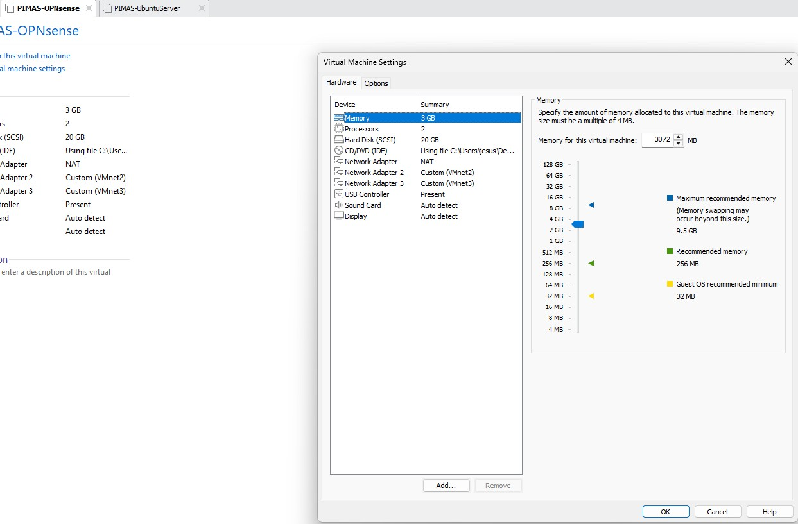

Inicialmente, la máquina virtual OPNsense tenía asignados 3 GB de memoria RAM. Se revisa esta configuración con el objetivo de reducir el consumo de recursos del laboratorio.

### CAPTURA E4-02 — Configuración de memoria de Ubuntu Server antes del ajuste

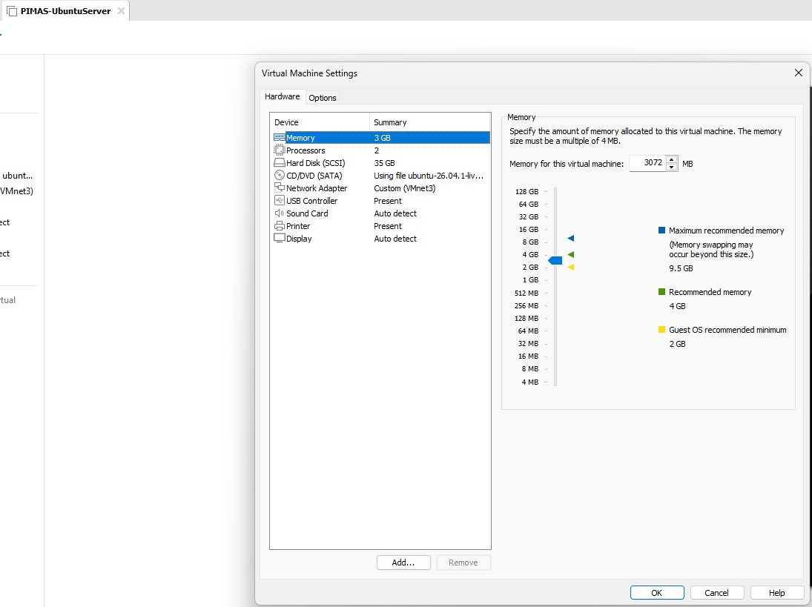

Se mantienen los 3 GB de memoria RAM asignados a Ubuntu Server para disponer de recursos suficientes durante la instalación y las pruebas de Apache, PHP, MariaDB y GLPI.

### CAPTURA E4-03 — Configuración de memoria tras los cambios y consumo real del equipo anfitrión

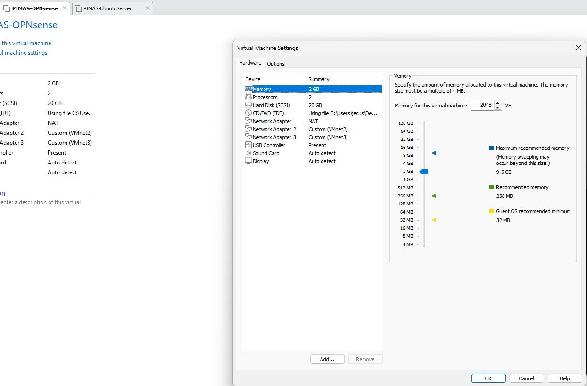

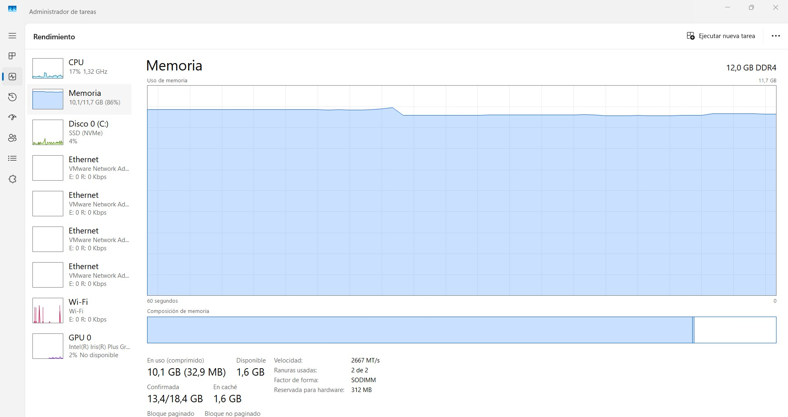

Tras reducir la memoria RAM de OPNsense de 3 GB a 2 GB, manteniendo Ubuntu Server con 3 GB, se ha comprobado el consumo del equipo anfitrión con ambas máquinas virtuales encendidas.

| Indicador | Antes | Después |
|---|---|---|
| Consumo de memoria RAM | 96 % | 86 % |
| Memoria utilizada | 11,2 GB | 10,1 GB |

Tras el ajuste quedan aproximadamente 1,6 GB disponibles. Esta modificación permite reducir el consumo de memoria sin disminuir los recursos asignados a Ubuntu Server.

## 3. Coherencia del direccionamiento y topología

Las redes 10.10.10.0/24 y 10.10.20.0/24 se establecieron durante la fase de diseño preliminar.

Durante la implementación se utilizaron las redes 192.168.10.0/24 para usuarios y 192.168.20.0/24 para servidores, estableciéndose como direccionamiento definitivo del laboratorio.

| Elemento | Dirección IP o configuración |
|---|---|
| OPNsense WAN (em0) | DHCP mediante NAT de VMware |
| OPNsense LAN (em1) | 192.168.10.1/24 |
| OPNsense OPT1 (em2) | 192.168.20.1/24 |
| Ubuntu Server | 192.168.20.10/24 |
| Cliente Windows 11 | 192.168.10.2 |

### CAPTURA E4-04 — Configuración de interfaces y direcciones IP en el entorno desplegado

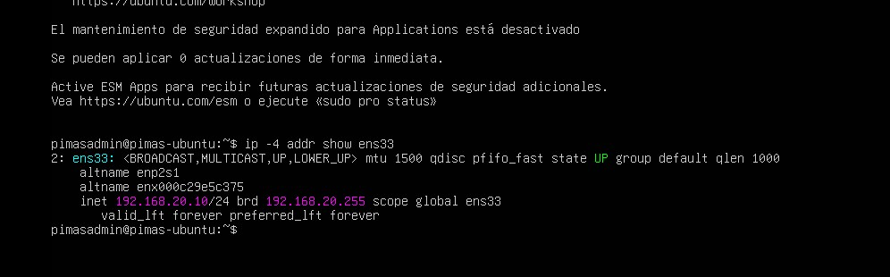

Mediante el comando `ip -4 addr show ens33` se ha comprobado que Ubuntu Server mantiene la dirección IP estática 192.168.20.10/24 después del reinicio.

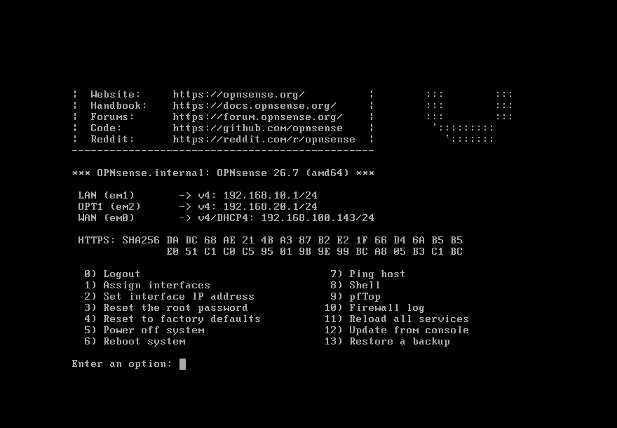

Se ha comprobado desde la consola de OPNsense que las interfaces mantienen el direccionamiento establecido durante la implementación.

Esta configuración permite mantener separadas las redes de usuarios y servidores, utilizando OPNsense como punto de comunicación y filtrado entre ambas.

## 4. Instalación y configuración del servidor web y PHP

Se ha preparado el entorno web de Ubuntu Server mediante la instalación de Apache2, PHP y las extensiones necesarias para GLPI.

### CAPTURA E4-05 — Instalación y versiones de servidor web y PHP

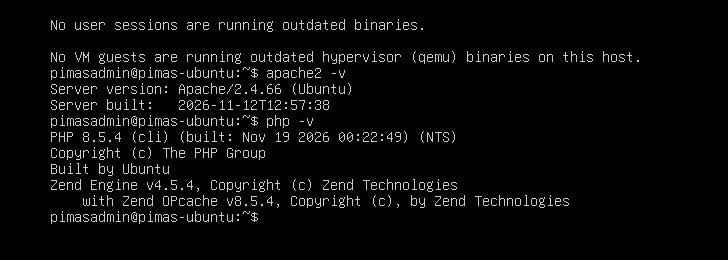

Mediante los comandos `apache2 -v` y `php -v` se ha comprobado la instalación de las siguientes versiones:

| Componente | Versión |
|---|---|
| Apache | 2.4.66 |
| PHP | 8.5.4 |

Se han incorporado las extensiones necesarias para la conexión con MariaDB, el tratamiento de imágenes, la gestión de idiomas, archivos XML y archivos comprimidos, así como funcionalidades adicionales de autenticación y caché.

Durante la instalación se detectó que el paquete php-imap no estaba disponible en los repositorios utilizados. Al tratarse de una extensión opcional para las funciones iniciales previstas, se decidió continuar sin ella.

### CAPTURA E4-06 — Comprobación de servicio web y acceso HTTP desde el cliente

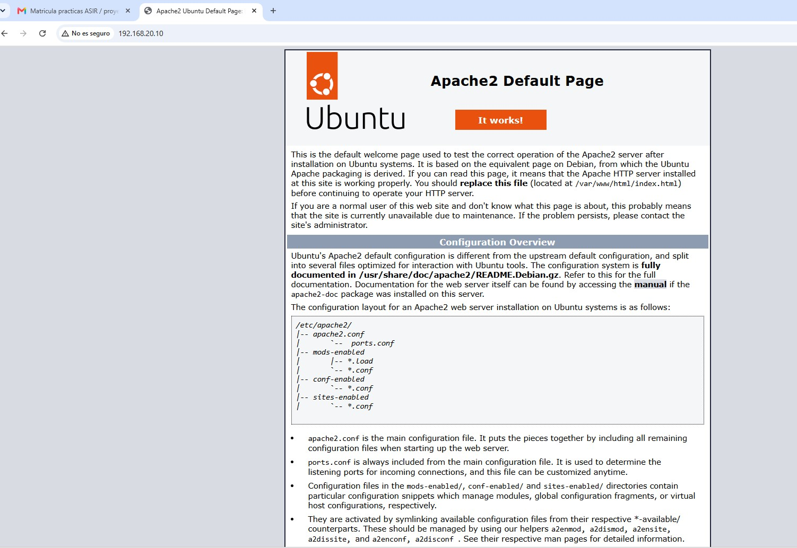

Se ha realizado una prueba de acceso HTTP desde el equipo anfitrión Windows 11 hacia Ubuntu Server mediante la dirección `http://192.168.20.10`.

El navegador ha mostrado correctamente la página predeterminada de Apache2, confirmando que el servidor web se encuentra operativo y es accesible desde la red de usuarios.

## 5. Instalación y configuración de MariaDB

Se ha instalado y configurado MariaDB como sistema gestor de bases de datos para GLPI.

Se ha creado una base de datos independiente y un usuario específico con permisos limitados a dicha base de datos.

### CAPTURA E4-07 — Servicio MariaDB activo y versión instalada

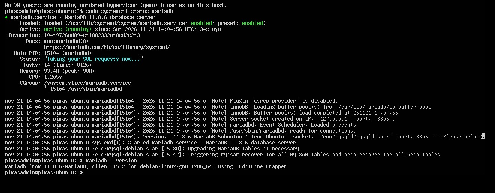

Se ha instalado MariaDB 11.8.6. Mediante el comando `systemctl status mariadb` se ha comprobado que el servicio está activo y habilitado para iniciarse automáticamente.

La versión instalada se ha verificado mediante `mariadb --version`.

### CAPTURA E4-08 — Base de datos y permisos del usuario de GLPI

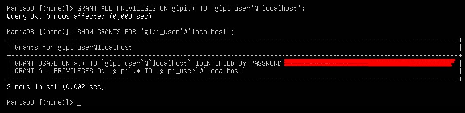

Se ha creado la base de datos `glpi` con codificación utf8mb4 y un usuario específico denominado `glpi_user`, limitado a conexiones locales.

Se han concedido los privilegios necesarios sobre la base de datos glpi, sin otorgar permisos administrativos sobre el resto de las bases de datos del servidor.

Mediante `SHOW GRANTS` se ha verificado que los permisos están correctamente asignados.

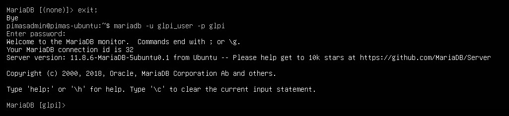

Se ha realizado una prueba de conexión mediante el comando:

```bash
mariadb -u glpi_user -p glpi
```

La autenticación se ha completado correctamente y se ha accedido a la base de datos glpi, verificando que el usuario de la aplicación dispone de acceso sin utilizar la cuenta administradora.

## 6. Instalación y puesta en marcha de GLPI

Se ha instalado y puesto en funcionamiento GLPI 12.0.2 en Ubuntu Server, utilizando Apache2 como servidor web y MariaDB 11.8.6 como gestor de bases de datos.

Durante el proceso se ha verificado la compatibilidad del entorno mediante el instalador de GLPI.

### CAPTURA E4-09 — Comprobación de requisitos del instalador de GLPI

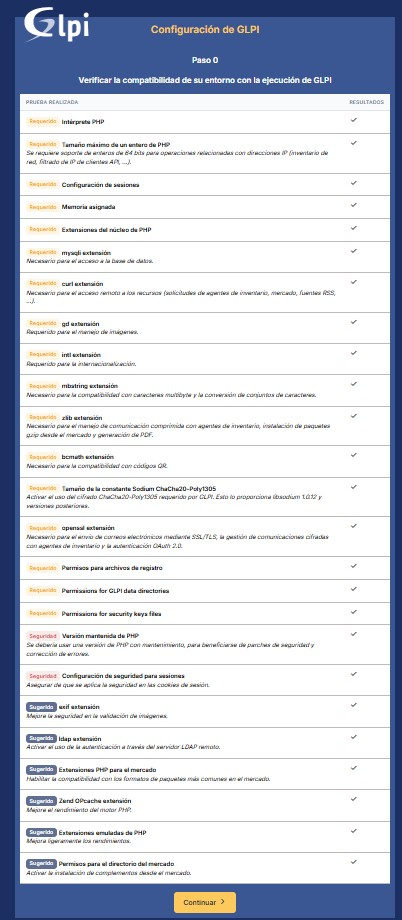

Se ha comprobado la compatibilidad del entorno, incluyendo la versión de PHP, las extensiones necesarias y los permisos de los directorios.

Tras una incidencia durante la inicialización de la base de datos desde la interfaz web, se completó la instalación mediante la consola de GLPI, generando correctamente las tablas, los datos iniciales y las claves de seguridad.

### CAPTURA E4-10 — Instalación finalizada y acceso a GLPI desde el navegador

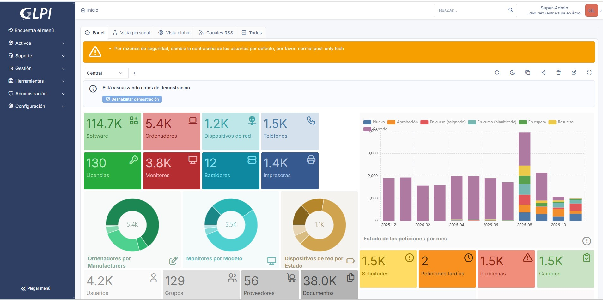

Se ha comprobado el acceso al panel de administración desde el equipo anfitrión Windows 11 mediante la dirección `http://192.168.20.10/`, confirmando el funcionamiento del servicio web y la comunicación entre las redes configuradas en OPNsense.

Finalmente, se ha modificado la contraseña predeterminada de la cuenta administradora.

## 7. Usuarios, perfiles y pruebas de acceso en GLPI

### CAPTURA E4-11 — Configuración de usuarios y perfiles de prueba

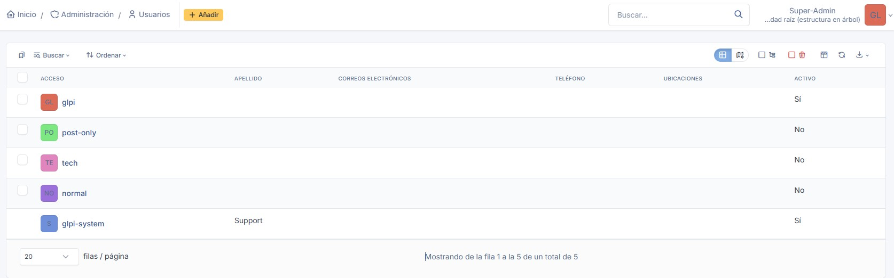

Se ha accedido al apartado Administración > Usuarios de GLPI para revisar las cuentas creadas automáticamente durante la instalación y aplicar medidas básicas de seguridad.

| Cuenta | Estado tras la revisión |
|---|---|
| glpi | Activa, contraseña modificada |
| glpi-system | Activa |
| post-only | Desactivada |
| tech | Desactivada |
| normal | Desactivada |

Se han mantenido activas las cuentas glpi, utilizada para la administración de la aplicación, y glpi-system, correspondiente al funcionamiento interno del sistema.

### CAPTURA E4-12 — Verificación de diferencias de acceso entre perfiles


Se ha realizado una prueba de acceso utilizando la cuenta `empleado.prueba`, creada en GLPI y configurada con el perfil Self-Service.

El inicio de sesión se ha completado correctamente desde una ventana de incógnito del navegador del equipo anfitrión Windows 11.

Se ha comprobado que el usuario accede a una interfaz simplificada, orientada a la comunicación de incidencias, solicitud de servicios y consulta de peticiones, sin mostrar las opciones de administración disponibles para el perfil Super-Admin.

## 8. Servicio documental y permisos de carpetas

Se ha implementado Samba como servicio de archivos independiente de GLPI, destinado al almacenamiento de documentación fiscal y laboral.

Se han creado dos carpetas compartidas, General y Confidencial, con permisos diferenciados mediante los grupos empleados y direccion.

La elección de Samba permite acceder a los recursos compartidos desde Windows 11 sin necesidad de instalar aplicaciones adicionales.

### CAPTURA E4-13 — Estructura de carpetas y configuración de permisos

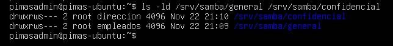

| Carpeta | Ruta | Grupo asignado | Permisos |
|---|---|---|---|
| General | /srv/samba/general | empleados | 2770 |
| Confidencial | /srv/samba/confidencial | direccion | 2770 |

Esta configuración restringe el acceso a los usuarios autorizados. El permiso setgid permite que los nuevos elementos hereden el grupo del directorio correspondiente.

### CAPTURA E4-14 — Acceso autorizado desde un usuario de prueba

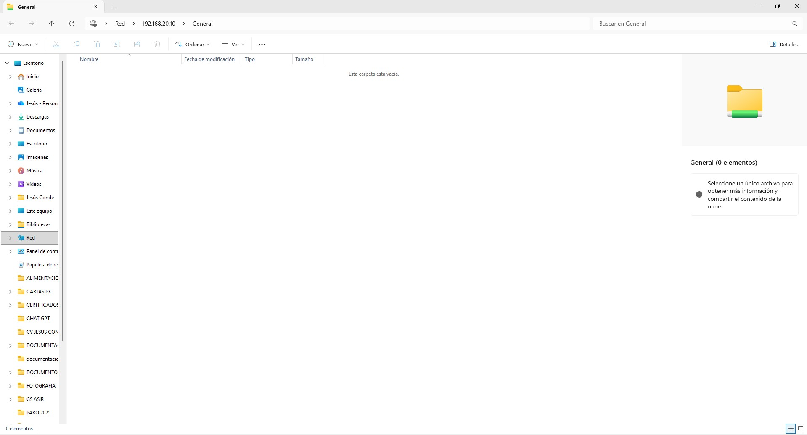

Se verifica que el usuario empleado1 puede acceder desde Windows 11 a la carpeta compartida General mediante Samba, confirmando el funcionamiento de la conexión y los permisos asignados.

### CAPTURA E4-15 — Denegación de acceso a una carpeta sin autorización

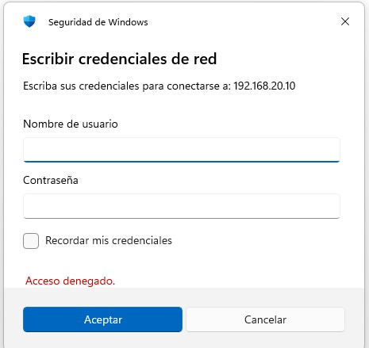

Se comprueba que el usuario empleado1 no puede acceder a la carpeta Confidencial, ya que no pertenece al grupo direccion.

Samba deniega el acceso, confirmando el funcionamiento de los permisos establecidos en la prueba realizada.

## 9. Reglas de cortafuegos y comprobaciones de red

Se han configurado reglas de cortafuegos en OPNsense para controlar el tráfico entre la red de usuarios (192.168.10.0/24) y la red de servidores (192.168.20.0/24).

### CAPTURA E4-16 — Reglas de OPNsense aplicadas a los nuevos servicios

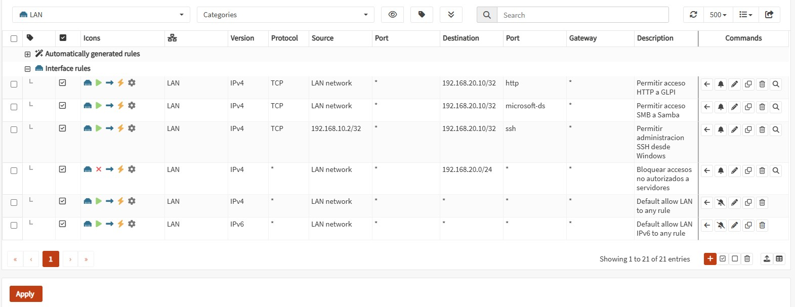

| Servicio | Origen | Destino | Protocolo y puerto | Acción |
|---|---|---|---|---|
| GLPI | Red de usuarios | 192.168.20.10 | TCP/80 | Permitir |
| Samba | Red de usuarios | 192.168.20.10 | TCP/445 | Permitir |
| SSH | Equipo autorizado | 192.168.20.10 | TCP/22 | Permitir |
| Resto del tráfico IPv4 hacia servidores | Red de usuarios | 192.168.20.0/24 | Cualquiera | Bloquear |

Las reglas específicas de acceso se sitúan antes de la regla de bloqueo de accesos no autorizados a la red de servidores.

### CAPTURA E4-17 — Prueba de conexión permitida y registro correspondiente

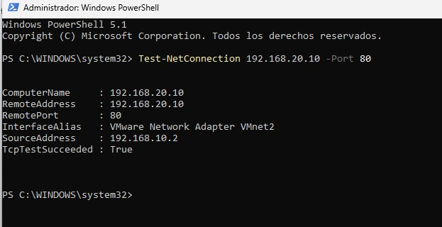

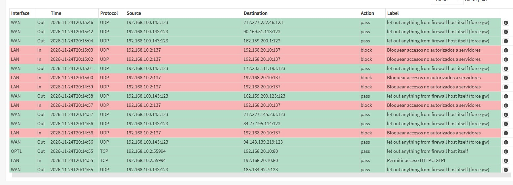

Se verifica mediante PowerShell la conexión al puerto TCP/80 del servidor Ubuntu.

```powershell
Test-NetConnection 192.168.20.10 -Port 80
```

Resultado: `TcpTestSucceeded : True`.

OPNsense registra el tráfico como permitido, confirmando el funcionamiento de la regla de acceso a GLPI.

### CAPTURA E4-18 — Prueba de conexión bloqueada y registro correspondiente

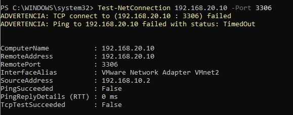

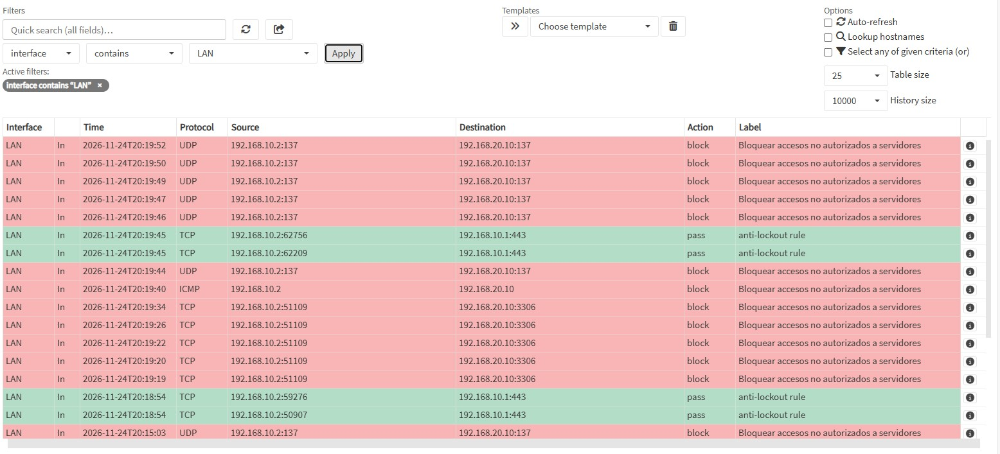

Se realiza una prueba de conexión directa al puerto TCP/3306 de MariaDB desde la red de usuarios.

```powershell
Test-NetConnection 192.168.20.10 -Port 3306
```

Resultado: `TcpTestSucceeded : False`.

OPNsense registra los intentos de conexión como bloqueados, impidiendo el acceso directo no autorizado a la base de datos.

## 10. Pruebas funcionales e incidencias

| Prueba | Resultado esperado | Resultado obtenido | Evidencia |
|---|---|---|---|
| Acceso a GLPI | Acceso correcto desde Windows | Correcto | E4-10, E4-17 |
| Conexión GLPI-MariaDB | Conexión operativa con la base de datos | Correcto. Autenticación en MariaDB y funcionamiento de GLPI | E4-07, E4-08, E4-10 |
| Acceso según perfil GLPI | Acceso limitado según el perfil asignado | Correcto | E4-11, E4-12 |
| Acceso autorizado a carpeta | Acceso a General | Correcto | E4-14 |
| Acceso denegado a carpeta | Bloqueo de acceso a Confidencial | Correcto | E4-15 |
| Filtrado de OPNsense | Permitir tráfico autorizado y bloquear el resto del tráfico IPv4 hacia servidores | Correcto en las pruebas realizadas | E4-16, E4-17, E4-18 |

### Incidencias y soluciones

Durante la implementación se han producido las siguientes incidencias:

- **Error 404 en GLPI:** solucionado mediante la revisión de la configuración de Apache.
- **Error 500 en GLPI:** corregido ajustando la configuración de reescritura de Apache.
- **Error de registro de usuario en Samba:** solucionado verificando la existencia del usuario en Ubuntu y repitiendo su registro en Samba.
- **Paquete php-imap no disponible:** se continuó la instalación sin esta extensión opcional.
- **Error de inicialización de la base de datos de GLPI:** solucionado completando la instalación mediante la consola de GLPI.

Tras aplicar las correcciones, se han repetido las pruebas correspondientes, obteniendo resultados satisfactorios.

## 11. Repositorio y publicación de la documentación

- [Repositorio GitHub](https://github.com/JCondeB/PIMAS-ASIR)
- [Documentación publicada mediante GitHub Pages](https://jcondeb.github.io/PIMAS-ASIR/)

Se ha incorporado la documentación de la Entrega 4 al repositorio GitHub en formato Markdown, junto con las evidencias gráficas de la implementación y las pruebas realizadas.

La publicación de esta entrega se realizará mediante MkDocs y GitHub Pages.

La evidencia E4-19 se incorporará al documento de entrega tras comprobar la publicación.

## 12. Valoración del estado del proyecto y siguientes pasos

Durante esta fase se ha completado la implementación de GLPI, MariaDB, Apache y Samba sobre Ubuntu Server, así como la gestión de usuarios, perfiles y permisos de acceso.

También se han configurado y verificado las reglas de filtrado de OPNsense entre las redes de usuarios y servidores.

Las pruebas funcionales realizadas han obtenido resultados satisfactorios y las incidencias detectadas durante la implementación han sido resueltas.

Como limitaciones, el entorno dispone de recursos de hardware reducidos y el acceso a GLPI se realiza actualmente mediante HTTP.

En la siguiente fase se abordarán las siguientes tareas:

- Copias de seguridad y pruebas de restauración.
- Acceso remoto mediante VPN según su viabilidad.
- Configuración de HTTPS.
- Centralización de registros.
- Valoración de mecanismos IDS/IPS.
- Bastionado de los servicios.
- Comprobaciones finales de seguridad.

---

PIMAS · Asesoría Tajo Gestión · Entrega 4
